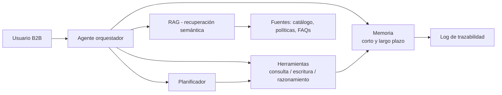
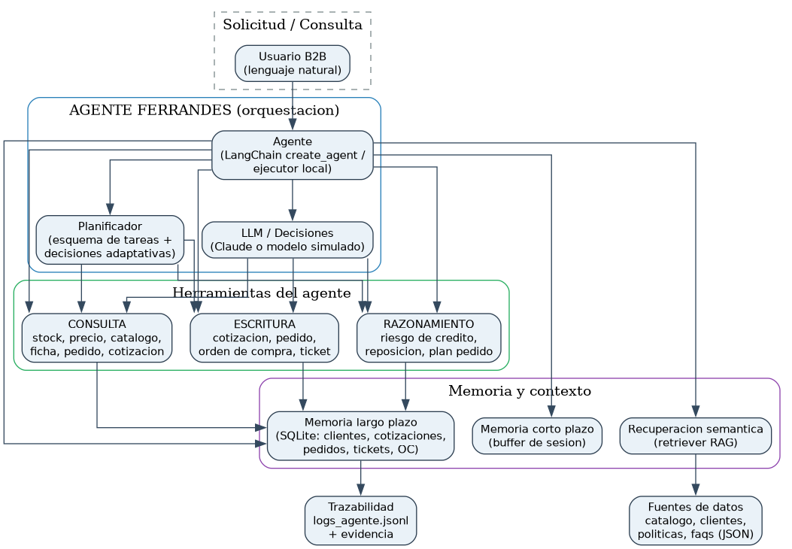
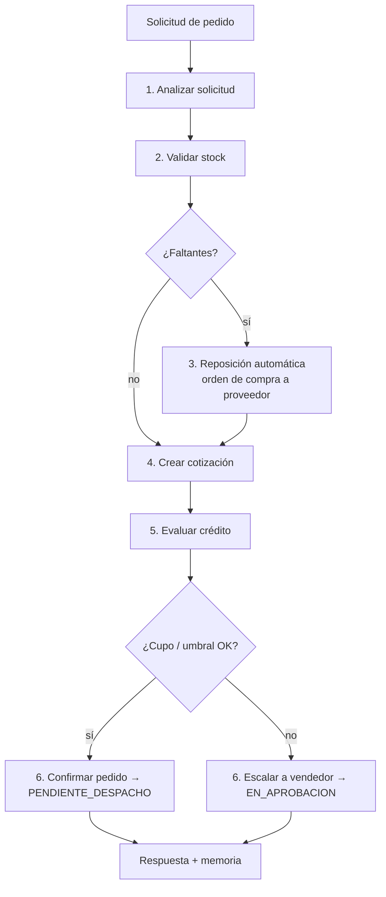
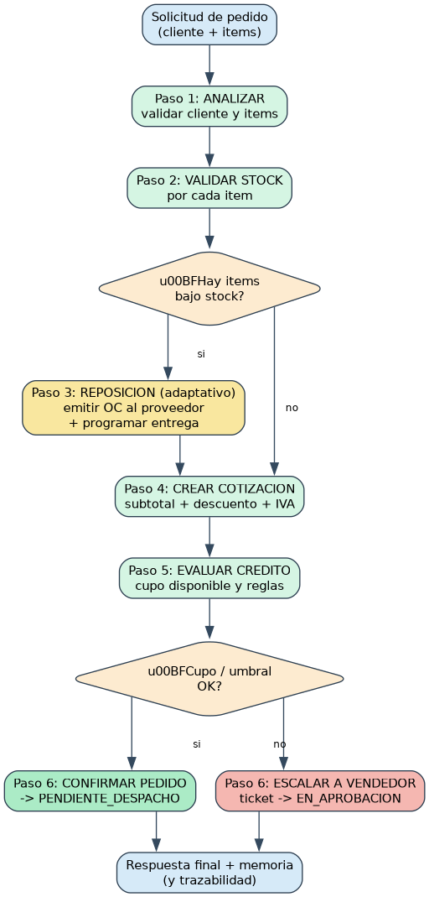

# Agente Ferrandes — Ferretería Industrial Andes (EP2 · ISY0101)

Repositorio de la **Evaluación Parcial N°2** de la asignatura **Ingeniería de
Soluciones con IA (ISY0101)**: desarrollo de un **agente funcional** que integra
**herramientas de consulta, escritura y razonamiento** para automatizar el flujo
B2B de ventas de la empresa ficticia **Ferretería Industrial Andes SpA
(FERRANDES)**, Concepción, Chile.

Este proyecto continúa la línea de trabajo iniciada en la EP1 (prototipo RAG de
asistente virtual) aplicada a un **caso organizacional distinto**, tal como se
solicita en la pauta: ahora el sistema deja de ser un chatbot de respuestas y se
convierte en un **agente que ejecuta acciones reales** (cotiza, confirma
pedidos, emite órdenes de reposición, escala a vendedores) con **memoria**,
**planificación** y **decisión adaptativa**.

---

## 📁 Contenido del repositorio

```
Ferrandes_Agente_EP2/
├── README.md                     ← este documento
├── requirements.txt              ← dependencias (opcional: API real + LangChain)
├── .env.example                  ← plantilla de variables de entorno
├── .gitignore
├── src/                          ← código fuente del agente
│   ├── config.py                 ← reglas de negocio, umbrales, rutas
│   ├── datos.py                  ← carga de fuentes (JSON)
│   ├── buscar_contexto.py        ← retriever / recuperación semántica (RAG)
│   ├── servicios.py              ← contenedor de dependencias (dato + memoria)
│   ├── decisiones.py             ← clasificación de intención + política local
│   ├── planificador.py           ← esquema de planificación y control adaptativo
│   ├── agente.py                 ← agente orquestador local (referencia funcional)
│   ├── agente_langchain.py       ← agente LangChain `create_agent` (+ LLM simulado)
│   ├── herramientas_langchain.py ← tools tipo `StructuredTool` de LangChain
│   ├── datos/                    ← catálogo, clientes, políticas y FAQs (JSON)
│   ├── memoria/
│   │   ├── corto_plazo.py        ← buffer conversacional por sesión
│   │   └── largo_plazo.py        ← persistencia SQLite (memoria episódica/semántica)
│   └── herramientas/
│       ├── consulta.py           ← herramientas de CONSULTA
│       ├── escritura.py          ← herramientas de ESCRITURA
│       └── razonamiento.py       ← herramientas de RAZONAMIENTO
├── scripts/
│   ├── demo.py                   ← demo completa + evidencia de pruebas
│   └── smoke_langchain.py        ← smoke test del agente LangChain (offline)
├── tests/                        ← pruebas unitarias (unittest, sin dependencias)
│   └── ejecutar_tests.py
├── evidencia/                    ← evidencia generada por la ejecución
│   ├── evidencia_pruebas.txt
│   ├── evidencia_langchain.txt
│   └── logs_agente.jsonl
├── assets/                       ← diagramas (PNG + fuente .dot)
│   ├── diagrama_arquitectura.png
│   └── diagrama_flujo_pedido.png
├── informe/                      ← informe técnico (Word + fuente Markdown)
│   └── Informe_Tecnico_EP2_Ferrandes.docx
└── presentacion/                 ← guion y PPT de la defensa
```

---

## 🚀 Requisitos e instalación

- **Python 3.9+** (probado con Python 3.14).
- El **agente local y los tests no requieren dependencias** (usa solo la
  biblioteca estándar: `sqlite3`, `json`, `unittest`, etc.).
- Para el **agente LangChain** y respuestas con **LLM real** (Claude):

```bash
pip install -r requirements.txt
```

`.env.example`:

```
# Opcional: si está vacío, el agente opera con decisión simulada (sin costo)
ANTHROPIC_API_KEY=
# Modelo usado por el agente LangChain real (opcional)
FERRANDES_MODEL=claude-sonnet-4-6
```

---

## ▶️ Cómo ejecutar el sistema

### 0) Todo en uno

```bash
python scripts/ejecutar_todo.py
```

Ejecuta las 38 pruebas unitarias, la demo con evidencia y (si tienes LangChain
instalado) el smoke test del agente.

### 1) Mini demo + evidencia de pruebas (sin API, sin dependencias)

```bash
python scripts/demo.py
```

Ejecuta 11 escenarios (consulta, pedidos con faltantes de stock, decisiones de
crédito, cliente nuevo, derivación normativa, memoria corta/larga plazo,
recuperación semántica y **manejo de errores con replanificación**) y genera:

- `evidencia/evidencia_pruebas.txt` — salida completa de la ejecución.
- `evidencia/logs_agente.jsonl` — trazabilidad por consulta.
- `datos_ferrandes.db` — memoria de largo plazo persistente (SQLite).

### 2) Pruebas unitarias

```bash
python tests/ejecutar_tests.py
```

Valida herramientas, memoria de corto/largo plazo, recuperación semántica
(TF-IDF + métricas de calidad), esquema de planificación, decisiones adaptativas,
replanificación y priorización por criticidad (38 pruebas).

### 3) Agente LangChain (framework de agentes)

```bash
python scripts/smoke_langchain.py
```

Construye el grafo `start → model → tools → model → end` con
`langchain.agents.create_agent` y **13 herramientas reales**. Sin API key opera
con un modelo de chat simulado (compatible con LangChain); con
`ANTHROPIC_API_KEY` las herramientas son orquestadas por **Claude**. La
evidencia queda en `evidencia/evidencia_langchain.txt`.

### 4) Ejecutar en Google Colab (y guardar los resultados)

Abre el notebook **`colab/EP2_Agente_Ferrandes_Colab.ipynb`** en
[Google Colab](https://colab.research.google.com) y sigue las celdas en orden:

1. **Copiar el proyecto** — clona tu repositorio de GitHub o sube el ZIP
   `Proyecto_EP2_Ferrandes.zip` arrastrándolo al panel de archivos.
2. **Pruebas unitarias** — `tests/ejecutar_tests.py` (38 pruebas, sin instalar
   nada; el agente solo usa la librería estándar de Python).
3. **Demo + evidencia** — `scripts/demo.py` regenera `evidencia/` y
   `datos_ferrandes.db`.
4. *(Opcional)* **Smoke test LangChain** — instala `requirements.txt` y ejecuta
   `scripts/smoke_langchain.py`.
5. **GUARDAR los resultados (obligatorio antes de cerrar)** — tres opciones:
   - Descargar los artefactos a tu PC, uno por uno.
   - Guardar `evidencia/`, `assets/`, `informe/` y `presentacion/` en Google
     Drive (montando la unidad).
   - Generar y descargar un ZIP con todo.

> ⚠️ En Colab la carpeta `/content` es temporal: al cerrar la sesión se borra.
> Ejecuta siempre el **paso 5** antes de terminar para conservar la evidencia.

---

## 🧩 Arquitectura y orquestación

El agente se compone de un **orquestador** (el loop del agente), un
**planificador**, tres **familias de herramientas**, dos **niveles de memoria**
y un **retriever semántico**. La orquestación garantiza que cada decisión deje
rastro en la memoria de largo plazo (trazabilidad) y que tareas prolongadas
puedan retomarse en otra sesión.





### Orquestación por capas

| Capa | Componente | Rol |
|---|---|---|
| Entrada | `agente.py` / `agente_langchain.py` | Interpreta la intención y orquesta el ciclo observa → decide → actúa → observa |
| Planificación | `planificador.py` | Esquema de pasos priorizados por criticidad, inyección adaptativa y replanificación (IL5) |
| Herramientas | `consulta.py` / `escritura.py` / `razonamiento.py` | Acciones atómicas de lectura, escritura y decisión (IL2.1) |
| Memoria | `corto_plazo.py` / `largo_plazo.py` | Coherencia por sesión y estado persistente (IL2.2) |
| Contexto | `buscar_contexto.py` | Recuperación semántica sobre fuentes de la empresa (IL2.2) |
| Modelo | `ChatAnthropic` o `FerretiaLLMSimulado` | Generación "inteligente" de la siguiente acción |
| Datos | `src/datos/*.json` + `datos_ferrandes.db` | Catálogo, clientes, políticas, FAQs y registros |

---

## 🔧 Herramientas del agente

**Consulta (lectura):** `consultar_stock`, `consultar_precio`, `buscar_catalogo`,
`obtener_ficha_tecnica`, `consultar_pedido`, `consultar_cotizacion`.

**Escritura (efectos persistentes):** `crear_cotizacion`, `confirmar_pedido`,
`generar_orden_reposicion`, `crear_ticket_escalamiento`.

**Razonamiento (decisión):** `evaluar_riesgo_credito`, `decidir_reposicion`,
`planificar_pedido`.

Todas se exponen como `StructuredTool` de LangChain (esquema de argumentos
generado dinámicamente) y como funciones reutilizables por el ejecutor local.

---

## 🧠 Memoria y recuperación de contexto

- **Memoria de corto plazo:** buffer por sesión con resumen comprimido cuando se
  satura. Da coherencia a diálogos prolongados (ej. cotización y confirmación en
  el mismo chat).
- **Memoria de largo plazo:** SQLite con perfiles de clientes, cotizaciones,
  pedidos (con historial de etapas), tickets y órdenes de reposición. Una tarea
  iniciada en la sesión A puede retomarse en la sesión B (ver prueba
  `test_persistencia_entre_sesiones`).
- **Recuperación semántica (RAG):** retriever con **similitud coseno sobre
  vectores TF-IDF** (ponderación por frecuencia inversa de documento y
  normalización morfológica ligera) sobre el corpus documental de la empresa
  (catálogo, políticas y FAQs). Admite **embeddings densos** opcionales
  (`sentence-transformers`, modo `auto`) sin cambiar la interfaz, y expone
  `evaluar_recuperacion()` para medir su calidad (**hit-rate@k** y **MRR**).
  Resultado actual: **hit-rate@3 = 100 % / MRR = 1,00** sobre 8 consultas
  etiquetadas. Para activar embeddings sin tocar código, define
  `FERRANDES_RETRIEVER_MODE=auto` (o `embeddings`) — útil en Google Colab tras
  `pip install sentence-transformers`.

---

## 🗺️ Planificación y toma de decisiones

El planificador genera un **esquema priorizado** de 6 etapas para todo pedido
(cada paso tiene `prioridad` y `criticidad`, y `priorizar()` ordena por
criticidad), y **adapta** el flujo cuando el entorno cambia:





**Ejemplos de decisiones adaptativas demostrados en la evidencia:**

1. **Stock bajo:** al pedir `TOR-002` (stock 12, mínimo 150) el agente emite la
   orden de reposición OC-000001 y agenda la entrega en función de la
   reposición (decisión `ESTRATEGIA`).
2. **Crédito:** un monto que supera el cupo o el umbral de aprobación bloquea el
   pedido en `EN_APROBACION` y genera ticket para el vendedor (decisión
   `BLOQUEA`).
3. **Cliente nuevo:** sin historial, la operación se confirma con **pago contra
   entrega** (decisión `EVALUACION_CREDITO`).
4. **Guardrail normativo:** consultas sobre normativas de seguridad **no se
   responden con inventiva**: se derivan a un especialista vía ticket.
5. **Replanificación:** si la solicitud trae ítems inválidos (producto
   inexistente o cantidad ≤ 0), el agente los **descarta, lo informa y continúa**
   con los válidos en lugar de abortar (decisión `REPLANIFICACION`).

---

## 🧪 Evidencia de pruebas

- `evidencia/evidencia_pruebas.txt` — demo completa (11 escenarios).
- `evidencia/evidencia_langchain.txt` — traza del grafo LangChain offline.
- `evidencia/logs_agente.jsonl` — log por consulta (intención, herramientas
  usadas, fuentes RAG, respuesta).
- `tests/` — 38 pruebas unitarias.

---

## 📄 Documentación y presentación

- **Informe técnico (máx. 5 páginas):** `informe/Informe_Tecnico_EP2_Ferrandes.docx`
  (fuente en Markdown: `informe/Informe_Tecnico_EP2_Ferrandes.md`).
- **Presentación de la defensa (20 min):** `presentacion/Guión_Presentacion_EP2.md` +
  `presentacion/Presentacion_EP2_Ferrandes.pptx`.

---

## 🤖 Declaración de uso de IA

Este proyecto usó herramientas de IA (asistente de programación y redacción)
como apoyo para estructurar el código, los diagramas y el informe. Las
**decisiones de diseño, la justificación técnica y las reflexiones individuales**
son de autoría del equipo. Todas las fuentes y frameworks se citan en el informe
(sección Referencias, formato APA). Ver directrices: https://bibliotecas.duoc.cl/ia

---

## 👥 Integrantes y docente

| | |
|---|---|
| **Integrantes** | ⬅ _completar nombres_ |
| **Docente** | Juan Burgueño |
| **Asignatura** | ISY0101 · Ingeniería de Soluciones con IA |
| **Evaluación** | EP2 · Encargo con Presentación (35 %) |

## 📚 Referencias (APA)

- Anthropic. (2026). *Anthropic API documentation*. https://docs.anthropic.com
- LangChain. (2026). *LangChain documentation: Agents*. https://docs.langchain.com
- Duoc UC. (2026). *Bibliotecas: citas y referencias APA*. https://bibliotecas.duoc.cl